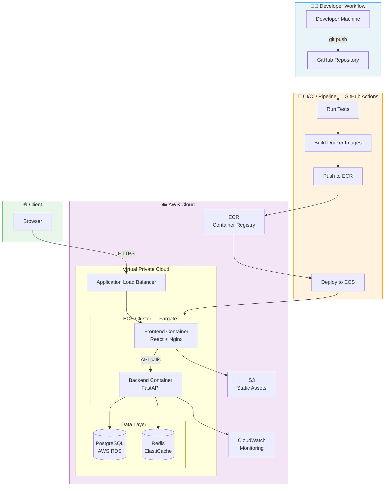

# DevFlow — Cloud-Native Deployment Management Platform

> ⚠️ **Status: Foundation Phase** — Project structure initialized. No application functionality implemented yet.

---

## 📋 Project Overview

DevFlow is a **cloud-native deployment management platform** that provides development teams with a centralized dashboard to manage, monitor, and control application deployments across AWS infrastructure.

The platform automates the deployment pipeline from code commit to production, offering real-time visibility into deployment health, rollback capabilities, and infrastructure cost tracking — all from a single interface.

This project is being built as a professional portfolio piece, developed incrementally across structured development sessions to demonstrate full-stack, cloud, and DevOps engineering skills.

---

## ❗ Problem Statement

Modern software teams face several deployment challenges:

- **Fragmented tooling** — teams juggle multiple dashboards: AWS Console, CI/CD logs, container registries, and monitoring tools with no unified view.
- **Deployment anxiety** — no easy way to compare what is running in production vs staging vs development at a glance.
- **Slow incident response** — identifying a bad deployment and triggering a rollback requires navigating multiple systems under pressure.
- **Infrastructure opacity** — developers rarely know the cost or resource impact of what they deploy.

DevFlow addresses these problems with a single, developer-friendly interface backed by automated infrastructure management.

---

## 🎯 Main Objectives

| # | Objective | Status |
|---|-----------|--------|
| 1 | Professional monorepo project structure | ✅ Complete |
| 2 | React + TypeScript frontend dashboard | 🔜 Planned |
| 3 | FastAPI backend REST API | 🔜 Planned |
| 4 | PostgreSQL data persistence | 🔜 Planned |
| 5 | Docker containerization | 🔜 Planned |
| 6 | AWS cloud deployment (ECS / RDS) | 🔜 Planned |
| 7 | Terraform infrastructure-as-code | 🔜 Planned |
| 8 | GitHub Actions CI/CD pipeline | 🔜 Planned |
| 9 | Deployment monitoring and alerting | 🔜 Planned |
| 10 | Rollback and canary deployment support | 🔜 Planned |

---

## 🛠️ Planned Technology Stack

### Frontend
| Technology | Purpose |
|------------|---------|
| React 18 | UI component framework |
| TypeScript | Type-safe JavaScript |
| Vite | Fast build tooling |
| TailwindCSS | Utility-first styling |
| React Query | Server state management |
| React Router | Client-side routing |

### Backend
| Technology | Purpose |
|------------|---------|
| Python 3.12 | Primary language |
| FastAPI | Async REST API framework |
| SQLAlchemy | ORM / database abstraction |
| Alembic | Database migrations |
| Pydantic | Data validation and serialization |
| Uvicorn | ASGI production server |

### Data
| Technology | Purpose |
|------------|---------|
| PostgreSQL 15 | Primary relational database |
| Redis | Caching and task queuing (planned) |

### Infrastructure & DevOps
| Technology | Purpose |
|------------|---------|
| Docker | Containerization |
| Docker Compose | Local multi-service orchestration |
| AWS ECS (Fargate) | Container hosting |
| AWS RDS | Managed PostgreSQL |
| AWS ALB | Load balancing |
| Terraform | Infrastructure-as-code |
| GitHub Actions | CI/CD automation |

---

## 🏗️ High-Level Architecture

> This is a **preliminary architecture diagram** representing the planned system design. It will evolve as implementation progresses.



---

## 📊 Current Development Status

```
Phase 1 — Foundation        [████████████████████] 100% ✅
Phase 2 — Frontend          [░░░░░░░░░░░░░░░░░░░░]   0% 🔜
Phase 3 — Backend API       [░░░░░░░░░░░░░░░░░░░░]   0% 🔜
Phase 4 — Database          [░░░░░░░░░░░░░░░░░░░░]   0% 🔜
Phase 5 — Docker            [░░░░░░░░░░░░░░░░░░░░]   0% 🔜
Phase 6 — AWS Deployment    [░░░░░░░░░░░░░░░░░░░░]   0% 🔜
Phase 7 — Terraform IaC     [░░░░░░░░░░░░░░░░░░░░]   0% 🔜
Phase 8 — CI/CD Pipeline    [░░░░░░░░░░░░░░░░░░░░]   0% 🔜
```

---

## 🗓️ Planned Implementation Milestones

### ✅ Day 1 — Project Foundation *(Current)*
- [x] Monorepo directory structure
- [x] Git repository initialized on `main` branch
- [x] Professional `.gitignore`
- [x] Project `README.md`
- [x] `.env.example` configuration template

### 🔜 Day 2 — Frontend Scaffold
- [ ] Vite + React + TypeScript project initialization
- [ ] TailwindCSS configuration
- [ ] Project routing structure
- [ ] Base component library setup
- [ ] Dashboard layout skeleton

### 🔜 Day 3 — Backend Scaffold
- [ ] FastAPI application structure
- [ ] Pydantic models
- [ ] Health check and base API endpoints
- [ ] Project configuration management
- [ ] Unit test foundation (pytest)

### 🔜 Day 4 — Database Layer
- [ ] PostgreSQL schema design
- [ ] SQLAlchemy models
- [ ] Alembic migration setup
- [ ] Database seeding scripts

### 🔜 Day 5 — Docker & Local Orchestration
- [ ] Frontend `Dockerfile`
- [ ] Backend `Dockerfile`
- [ ] `docker-compose.yml` for local development
- [ ] Container networking and volume configuration

### 🔜 Day 6 — AWS Infrastructure (Terraform)
- [ ] VPC and networking resources
- [ ] ECS Fargate cluster and task definitions
- [ ] RDS PostgreSQL instance
- [ ] ALB and target group configuration
- [ ] IAM roles and security groups

### 🔜 Day 7 — CI/CD Pipeline
- [ ] GitHub Actions workflow for testing
- [ ] Docker build and ECR push pipeline
- [ ] Automated deployment to ECS
- [ ] Environment-based deployment gates (staging → production)

### 🔜 Day 8 — Features & Polish
- [ ] Real-time deployment status updates
- [ ] Rollback functionality
- [ ] Deployment history and audit logs
- [ ] CloudWatch metrics integration

---

## 📁 Project Structure

```
devflow-cloud-deployment-platform/
├── frontend/               # React + TypeScript application (Day 2+)
├── backend/                # FastAPI Python application (Day 3+)
├── infrastructure/
│   ├── terraform/          # AWS infrastructure-as-code (Day 6+)
│   └── scripts/            # Deployment and utility scripts
├── docs/                   # Architecture docs, ADRs, design notes
├── .github/
│   └── workflows/          # GitHub Actions CI/CD pipelines (Day 7+)
├── .env.example            # Configuration template (safe to commit)
├── .gitignore              # Git exclusion rules
└── README.md               # This file
```

---

## 🚀 Getting Started

> ⚠️ **Setup instructions will be added in Day 2** when the first runnable application code is introduced.

---

## 📄 License

This project is for educational and portfolio purposes.

---

*Last updated: Day 1 — Project Foundation*
