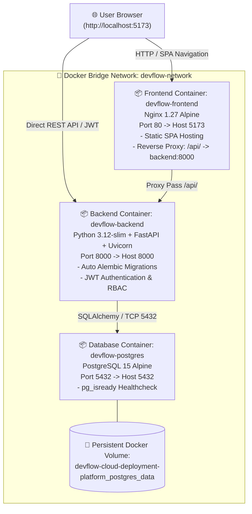

# DevFlow — Cloud-Native Deployment Management Platform


---

## 📋 Project Overview

**DevFlow** is a modern, full-stack, cloud-native deployment management platform that gives software engineering teams a unified dashboard to trigger, monitor, and manage multi-environment application releases.

DevFlow bridges the gap between source control commits and infrastructure operations, providing real-time deployment status transitions (`pending` → `running` → `succeeded` / `failed`), user ownership isolation, health monitoring, and auditability.

---

## 🏗️ Architecture & Container Orchestration

DevFlow is fully containerized and orchestrated via Docker Compose with dedicated health checks and isolated networking.



---

## 🛠️ Technology Stack

### Frontend Service
- **Framework**: React 18 with TypeScript 5
- **Tooling**: Vite 6, Tailwind CSS 3 (Dark Slate Theme), Lucide Icons
- **State & Data**: TanStack Query v5, Axios, Recharts
- **Production Server**: Nginx 1.27 Alpine with Gzip compression, HTTP security headers, and reverse proxy fallback

### Backend Service
- **Framework**: FastAPI 0.115 with Python 3.12
- **ORM & Migrations**: SQLAlchemy 2.0 with Alembic 1.14
- **Security**: JWT authentication (`python-jose`), bcrypt password hashing (`passlib`)
- **Validation**: Pydantic v2 schemas with strict status transitions
- **ASGI Server**: Uvicorn with automated startup migration entrypoint

### Database & Storage
- **Engine**: PostgreSQL 15 (Alpine)
- **Persistence**: Dedicated Docker named volume (`devflow-cloud-deployment-platform_postgres_data`)

### CI/CD & DevOps
- **Containerization**: Multi-stage Docker builds (`Dockerfile` + `.dockerignore`)
- **Orchestration**: Docker Compose with container healthchecks and dependency ordering
- **CI Pipeline**: GitHub Actions (`.github/workflows/ci.yml`) validating backend pytest suite, frontend TypeScript/build, and Docker Compose specification

---

## 🚀 Quick Start with Docker Compose

Ensure Docker and Docker Compose are installed and running.

### 1. Clone & Configure Environment
```bash
git clone https://github.com/DevG-26/devflow-cloud-deployment-platform.git
cd devflow-cloud-deployment-platform

# Copy the example environment file
cp .env.example .env
```

### 2. Build and Start All Services
```bash
docker compose up -d --build
```

### 3. Verify Container Health
```bash
docker compose ps
```
All three containers (`devflow-postgres`, `devflow-backend`, `devflow-frontend`) should report `healthy`.

### 4. Access the Application
- **Frontend Dashboard**: [http://localhost:5173](http://localhost:5173)
- **FastAPI Backend Root**: [http://localhost:8000](http://localhost:8000)
- **Interactive OpenAPI Docs**: [http://localhost:8000/docs](http://localhost:8000/docs)
- **API Health Check**: [http://localhost:8000/health](http://localhost:8000/health)
- **Database Readiness**: [http://localhost:8000/ready](http://localhost:8000/ready)

---

## 🐳 Docker Management Reference

| Command | Description |
|---------|-------------|
| `docker compose up -d` | Start all services in background |
| `docker compose up -d --build` | Rebuild images and restart containers |
| `docker compose ps` | Check running container status and health |
| `docker compose logs -f backend` | Stream backend server and migration logs |
| `docker compose logs -f frontend` | Stream Nginx access and error logs |
| `docker compose logs -f db` | Stream PostgreSQL database logs |
| `docker compose restart backend` | Restart backend container |
| `docker compose down` | Stop containers without removing persistent data |
| `docker compose down -v` | Stop containers and wipe database volume |

---

## ⚙️ Environment Variables

Configuration is loaded from `.env` at the project root:

| Variable | Description | Default / Example |
|----------|-------------|-------------------|
| `POSTGRES_USER` | PostgreSQL superuser name | `devflow` |
| `POSTGRES_PASSWORD` | PostgreSQL password | `devflow` |
| `POSTGRES_DB` | PostgreSQL database name | `devflow` |
| `DATABASE_URL` | SQLAlchemy connection URL | `postgresql://devflow:devflow@db:5432/devflow` |
| `SECRET_KEY` | JWT signing secret key | Long random secret string |
| `APP_NAME` | Application title in OpenAPI | `DevFlow API` |
| `APP_ENV` | Application environment (`development` / `production`) | `development` |
| `APP_PORT` | Backend host port binding | `8000` |
| `ACCESS_TOKEN_EXPIRE_MINUTES` | JWT token lifespan in minutes | `30` |
| `ALLOWED_ORIGINS` | CORS origins (comma-separated or JSON list) | `http://localhost:5173,http://127.0.0.1:5173` |
| `VITE_API_BASE_URL` | Frontend target API endpoint | `http://localhost:8000/api/v1` |
| `DEVFLOW_TEST_DATABASE_URL` | Isolated database URL for running pytest | `sqlite:///./test_devflow.db` |

---

## 📡 API Endpoints

### Health & Monitoring
| Method | Path | Auth | Description |
|--------|------|------|-------------|
| `GET` | `/health` | None | Returns `{ "status": "ok" }` |
| `GET` | `/ready` | None | Probes DB and returns `{ "database": "ready" }` |

### Authentication
| Method | Path | Auth | Description |
|--------|------|------|-------------|
| `POST` | `/api/v1/users/register` | None | Register account (`name`, `email`, `password`) |
| `POST` | `/api/v1/users/login` | None | Authenticate and obtain JWT Bearer token |

### Projects
| Method | Path | Auth | Description |
|--------|------|------|-------------|
| `GET` | `/api/v1/projects/` | Bearer JWT | List projects owned by authenticated user |
| `POST` | `/api/v1/projects/` | Bearer JWT | Create project (`name`, `description`, `repo_url`) |
| `GET` | `/api/v1/projects/{id}` | Bearer JWT | Retrieve project by ID (ownership enforced) |
| `PUT` | `/api/v1/projects/{id}` | Bearer JWT | Update project details |
| `DELETE` | `/api/v1/projects/{id}` | Bearer JWT | Delete project and cascade deployments |

### Deployments
| Method | Path | Auth | Description |
|--------|------|------|-------------|
| `GET` | `/api/v1/deployments/` | Bearer JWT | List all deployments for user's projects |
| `POST` | `/api/v1/deployments/` | Bearer JWT | Create deployment record (`project_id`, `environment`, `commit_sha`) |
| `GET` | `/api/v1/deployments/{id}` | Bearer JWT | Retrieve deployment details by ID |
| `GET` | `/api/v1/deployments/project/{project_id}` | Bearer JWT | List deployments for a specific project |
| `PATCH` | `/api/v1/deployments/{id}/status` | Bearer JWT | Transition deployment status (`pending` → `running` → `succeeded` / `failed`) |

---

## 🧪 Automated Testing

### Backend Test Suite (Pytest)
The backend includes 23 automated tests verifying user registration, authentication, project CRUD, deployment lifecycle, status transitions, and cross-user ownership isolation.
```bash
# Run tests against an isolated SQLite test database
$env:DEVFLOW_TEST_DATABASE_URL="sqlite:///./test_devflow.db"
cd backend
python -m pytest tests -v
```

### Frontend Verification
```bash
cd frontend
# TypeScript check
npx tsc --noEmit
# Production bundle build
npm run build
```

---

## 🔄 CI/CD Pipeline (GitHub Actions)

Located at `.github/workflows/ci.yml`, the pipeline runs automatically on every `push` and `pull_request` targeting `main`:
1. **Backend Checks**: Sets up Python 3.12, installs dependencies, and runs the 23-test pytest suite using an isolated SQLite database.
2. **Frontend Checks**: Sets up Node.js 20, runs `npm ci`, verifies TypeScript types (`tsc --noEmit`), and executes `vite build`.
3. **Docker Validation**: Validates the Docker Compose file (`docker compose config`) and performs Buildx test builds of both container images.

---

## 📊 Implementation Roadmap

| Milestone | Status | Details |
|-----------|--------|---------|
| **Day 1: Foundation** | ✅ Complete | FastAPI setup, PostgreSQL connection, SQLAlchemy base models, Alembic migrations |
| **Day 2: Core Backend** | ✅ Complete | JWT auth, Project/Deployment CRUD, ownership enforcement, 23 automated tests |
| **Day 3: Frontend SPA** | ✅ Complete | React 18, TypeScript, Tailwind dark theme, TanStack Query, Recharts metrics |
| **Day 4: Containerization & CI/CD** | ✅ Complete | Backend & Frontend Dockerfiles, Docker Compose stack, healthchecks, GitHub Actions |
| **Day 5: Cloud Deployment** | 📋 Planned | AWS ECS Fargate, RDS PostgreSQL, ALB, and Terraform IaC |

---

## 📄 License

This project is open-source under the MIT License for educational and portfolio demonstration.
