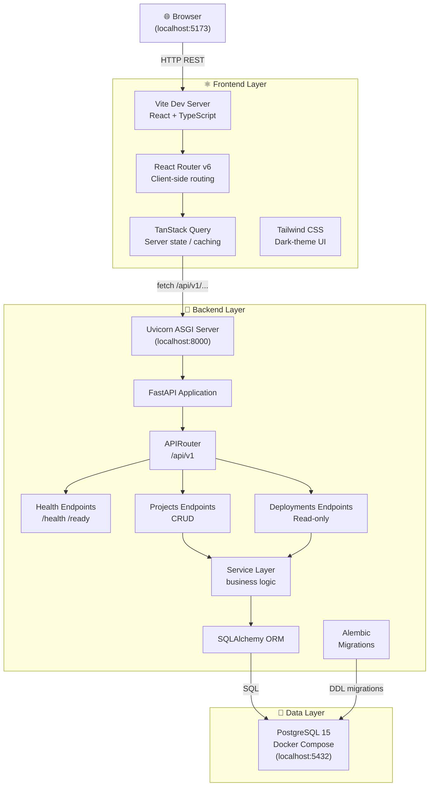
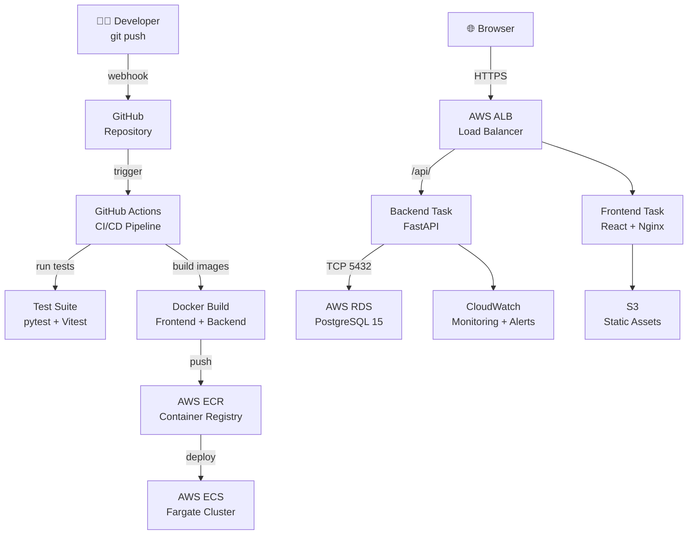
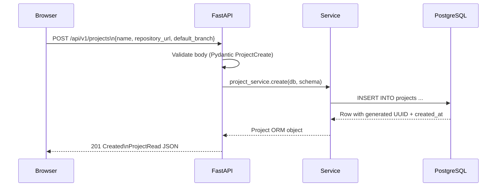
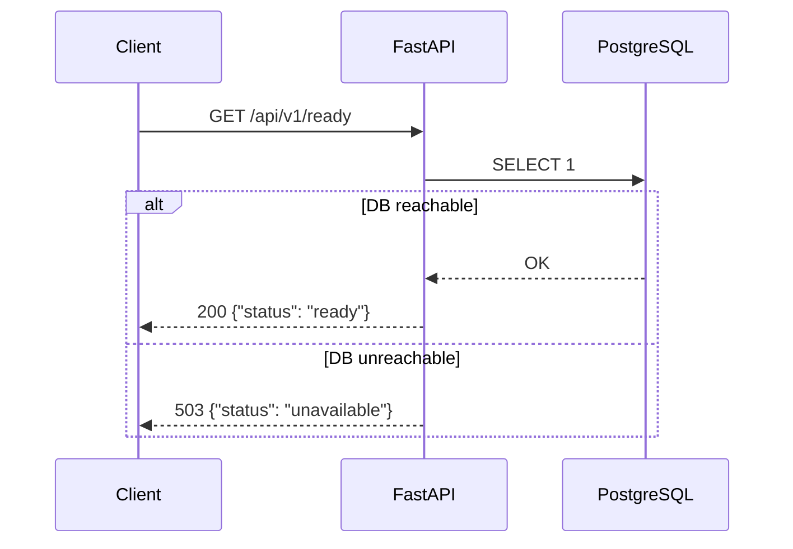
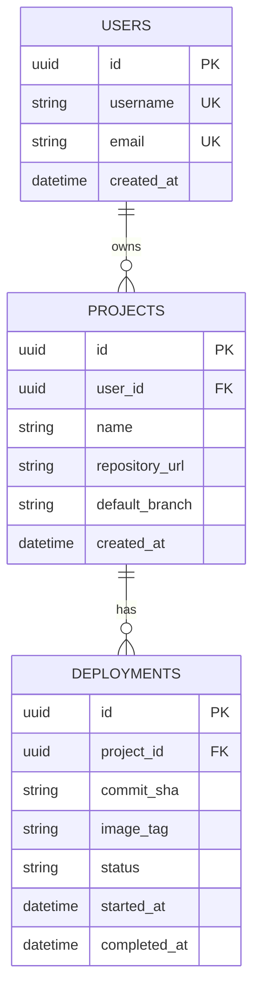

# DevFlow — Architecture Documentation

> This document provides a comprehensive technical overview of the DevFlow platform architecture, data model, API design, and security considerations.

---

## 1. System Architecture

### 1.1 Local Development Architecture

### 1.2 Production Architecture (Planned)

---

## 2. Component Descriptions

### 2.1 Frontend

| Component | Technology | Responsibility |
|-----------|-----------|----------------|
| Build tool | Vite 5 | Hot-module replacement, TypeScript compilation, production bundling |
| Framework | React 18 | Declarative UI via component tree |
| Routing | React Router v6 | Client-side navigation without full page reloads |
| Data fetching | TanStack Query v5 | Async server state, caching, background refetching |
| Styling | Tailwind CSS 3 | Utility-first dark-theme design system |
| Type safety | TypeScript 5 | Static analysis, IDE autocompletion, runtime confidence |
| Tests | Vitest + Testing Library | Unit and integration tests for components and hooks |

### 2.2 Backend

| Component | Technology | Responsibility |
|-----------|-----------|----------------|
| Framework | FastAPI 0.115 | Async request handling, OpenAPI schema generation |
| Config | Pydantic Settings 2 | Typed env-var loading from `.env` file |
| ORM | SQLAlchemy 2.0 | Python-to-SQL mapping, connection pooling |
| Migrations | Alembic 1.14 | Schema versioning and incremental DDL |
| Validation | Pydantic 2.10 | Request/response schema enforcement |
| Server | Uvicorn 0.32 | ASGI server (dev with `--reload`, prod with workers) |
| Linting | Ruff 0.8 | Fast Python linting and formatting |
| Tests | pytest 8.3 + httpx | In-memory SQLite test database, async test client |

### 2.3 Database

| Aspect | Detail |
|--------|--------|
| Engine | PostgreSQL 15 |
| Local | Docker Compose (single container) |
| Production | AWS RDS for PostgreSQL (Multi-AZ) |
| ORM | SQLAlchemy 2.0 declarative models |
| Migrations | Alembic (auto-generated from model changes) |
| Primary keys | UUID v4 (database-agnostic, non-sequential) |
| Timestamps | UTC, `server_default=func.now()` |

---

## 3. Data Flow

### 3.1 Create Project (POST /api/v1/projects)

### 3.2 Readiness Check (GET /api/v1/ready)

---

## 4. Database Schema

### 4.1 Key Constraints

| Table | Constraint | Detail |
|-------|-----------|--------|
| `users` | `username` | UNIQUE, indexed |
| `users` | `email` | UNIQUE, indexed |
| `projects` | `(user_id, name)` | UNIQUE together — no duplicate project names per user |
| `projects` | `user_id` | FK → `users.id`, indexed |
| `deployments` | `project_id` | FK → `projects.id`, indexed |
| `deployments` | `status` | Enum: `pending`, `running`, `success`, `failed` |
| `deployments` | `commit_sha` | Max 40 chars (Git SHA-1) |

---

## 5. API Design Decisions

### 5.1 Versioning Strategy

All API routes are prefixed with `/api/v1/`. This allows future breaking changes to be introduced under `/api/v2/` without disrupting existing clients.

### 5.2 UUID Primary Keys

UUIDs are used instead of auto-incrementing integers to:
- Avoid exposing record counts to external clients
- Enable client-side ID generation in future
- Support data merges across environments without collisions

### 5.3 Repository URL as String in Responses

`ProjectCreate` accepts `repository_url` as `HttpUrl` (Pydantic validates it), but `ProjectRead` returns it as `str`. This prevents Pydantic from serializing the URL object in a non-JSON-friendly way and keeps the response schema stable.

### 5.4 SQLite for Tests

The test suite uses an in-memory SQLite database (via `conftest.py`) so that tests run without requiring a live PostgreSQL instance or Docker. This enables CI to run unit/integration tests before Docker infrastructure is available.

### 5.5 Readiness vs. Liveness

- `/api/v1/health` → **liveness**: always returns 200 if the process is up. Used by Docker/ECS to know whether to restart the container.
- `/api/v1/ready` → **readiness**: checks the database connection. Used by load balancers to stop sending traffic when the DB is unavailable.

---

## 6. Security Considerations

| Area | Current Implementation | Production Recommendation |
|------|----------------------|--------------------------|
| Secrets | Loaded from `.env` via Pydantic Settings | AWS Secrets Manager / SSM Parameter Store |
| Auth | None (placeholder) | GitHub OAuth 2.0 → JWT session tokens |
| CORS | Configurable via `ALLOWED_ORIGINS` env var | Restrict to known frontend domains only |
| Transport | HTTP (dev) | HTTPS via ACM + ALB in production |
| DB credentials | In `.env` (never committed) | RDS IAM authentication or Secrets Manager rotation |
| SQL injection | Prevented by SQLAlchemy ORM parameterized queries | Maintain ORM usage; avoid raw SQL |
| Input validation | Pydantic v2 strict validation on all request bodies | Add rate limiting (slowapi) in production |
| Webhook verification | `GITHUB_WEBHOOK_SECRET` env var (planned) | HMAC-SHA256 signature validation on all webhook payloads |

---

## 7. Directory Conventions

| Directory | Owner | Rule |
|-----------|-------|------|
| `backend/app/models/` | Backend | One file per SQLAlchemy model |
| `backend/app/schemas/` | Backend | One file per resource (matches models) |
| `backend/app/api/v1/endpoints/` | Backend | One file per router (health, projects, deployments) |
| `backend/app/services/` | Backend | Business logic only — no HTTP concerns |
| `backend/app/database/` | Backend | Session and engine configuration only |
| `backend/migrations/versions/` | Alembic | Auto-generated; never hand-edit a committed migration |
| `frontend/src/api/` | Frontend | TanStack Query hooks and API client |
| `frontend/src/components/` | Frontend | Reusable, stateless UI components |
| `frontend/src/pages/` | Frontend | Route-level components (one per page) |
| `infrastructure/terraform/` | DevOps | AWS resource definitions (planned) |
| `docs/` | All | Architecture decisions, diagrams, ADRs |
